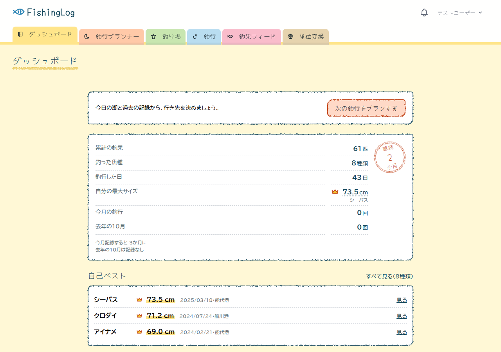
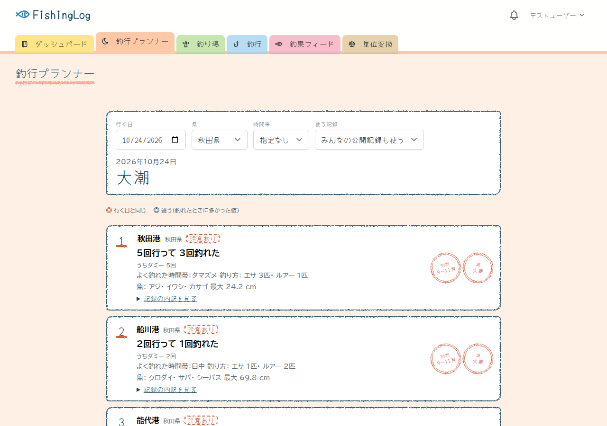
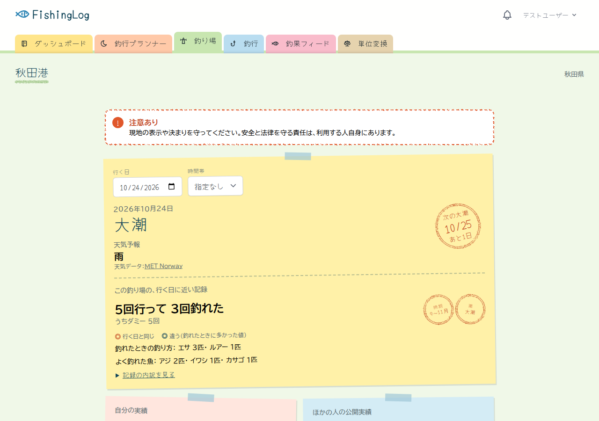
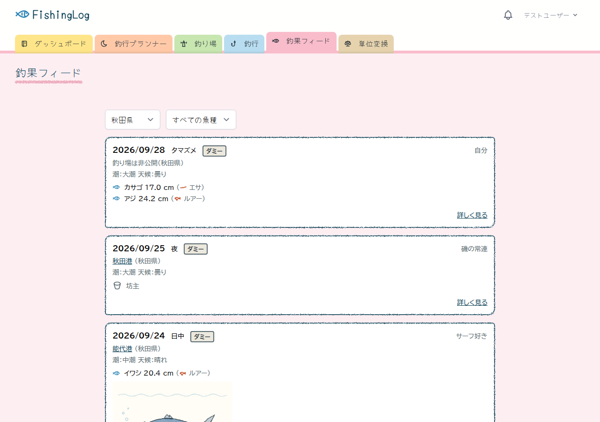
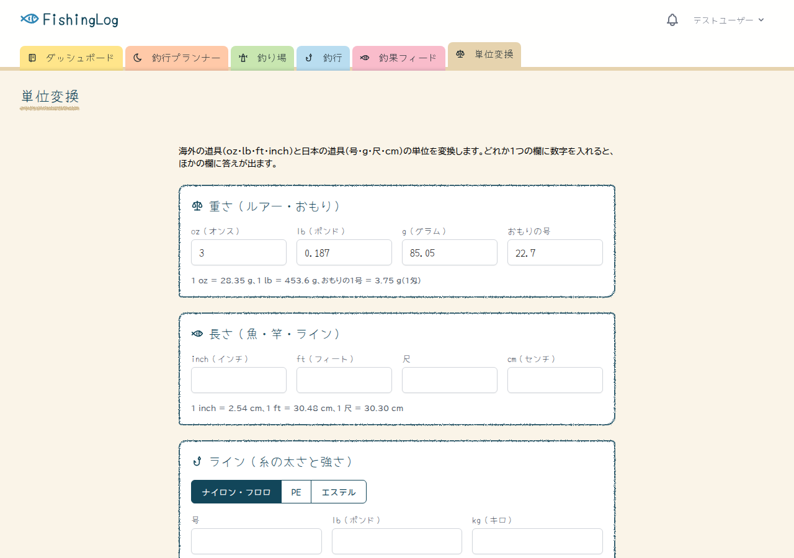
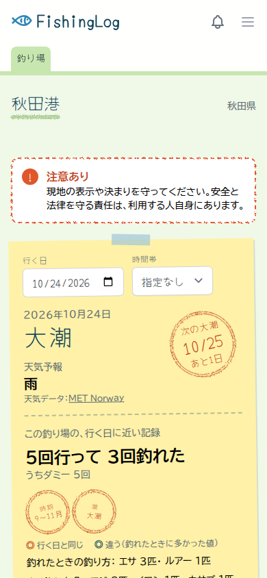
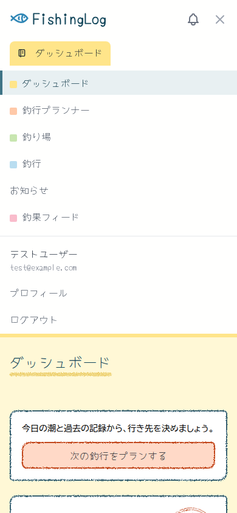
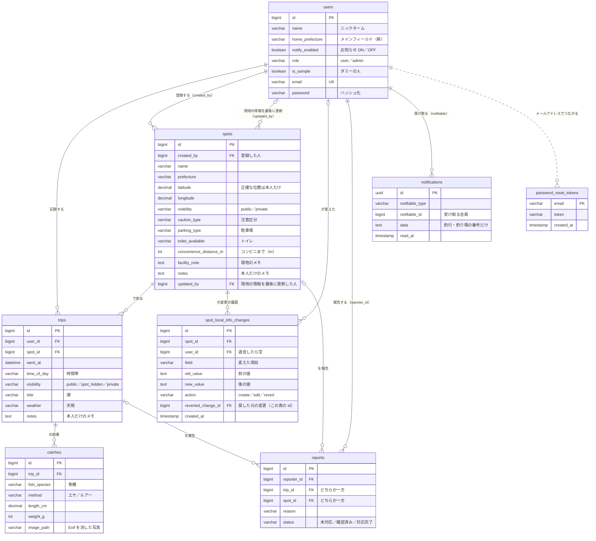

# FishingLog（釣果記録・釣り場情報共有アプリ）

[](https://github.com/kazuyuki-a-dev/fishing-log/actions/workflows/tests.yml)

釣行を記録していくと、「どの潮・時間帯・釣り方なら、何回行って何回釣れたか」が貯まっていき、次にどこへ行くかを決める材料になる Web アプリです。
月に1〜3回ほど釣りに行く人が、自分の記録とみんなの公開記録から「釣れる条件」を見つけることを目指しています。

- 主役は **釣行プランナー**（行く日と県を選ぶと、過去の記録から釣り場を提案）と **釣り場カルテ**（その釣り場で、選んだ日の条件のときにどうだったか）
- 定義書は [`docs/spec.md`](docs/spec.md)、定義書と違うことをしたときの判断と理由は [`docs/decisions.md`](docs/decisions.md) にすべて記録しています
- 定義書の要件ごとの状態（完了・一部対応など）・受け入れの条件・確かめ方・結果は [`docs/requirements.md`](docs/requirements.md) の対応表にまとめています
- 公開環境の動かし方（点検・報告への対応・鍵の管理・障害のとき）は [`docs/operations.md`](docs/operations.md)、本番として使うときに変えることは [`docs/release-plan.md`](docs/release-plan.md) にあります

## お試し環境

環境構築をしなくても、ブラウザで試せます。

| 項目 | 内容 |
| --- | --- |
| URL | https://fishing-log-hasx.onrender.com |
| お試し用アカウント | メールアドレス `demo@example.com` ／ パスワード `fishinglog-demo` |

### 付箋ごとに試せること

画面の上の付箋（スマホでは ≡ メニュー）から開けます。

| 付箋 | できること | 試してほしいこと |
| --- | --- | --- |
| ダッシュボード | 自分の記録のまとめ（累計・自己ベスト・連続記録のスタンプ・気づきカード） | 自己ベストの「すべて見る」と、「月ごとに釣れる魚を見る（シーズンヒートマップ）」も開いてみる |
| 釣行プランナー | 行く日を選ぶと、その日の潮と過去の記録から釣り場が並ぶ | 日付を変えてみる（県は最初から秋田県）。ログインしなくても、トップの「プランナーを試す」から、自分の県を選んで試せる |
| 釣り場 | 全国の実在の港と湖の一覧と、釣り場カルテ | 「秋田港」のカルテで、判断ビュー（潮・天気予報・何回行って何回釣れたか）と月×魚種の表を見る |
| 釣行 | 自分の釣行の記録・絞り込み・CSV 保存 | 「釣行を記録」で魚の写真を選ぶ（日時と近くの釣り場の候補が出る）。「絞り込む」「CSV で保存」も |
| 釣果フィード | みんなの全体公開の釣果 | 県で「秋田県」を選ぶ（サンプルのイラスト付きの釣果が出る） |
| 単位変換 | 重さ・長さ・ラインの単位の変換 | ラインの号を入れて、lb と kg を見る |

- お試し用アカウントは、だれでも使えます。**本物の個人情報や、知られたくない釣り場は入れないでください**。入れたデータは、ほかの人にも見えたり、消されたりすることがあります
- お試し用アカウントは、ニックネーム・メールアドレス・パスワードの変更と、退会ができません。釣行の記録・編集・削除は自由に試せます
- ログインしなくても、トップ・釣行プランナー・釣果フィード・釣り場カルテ・単位変換・使い方は見られます。ゲストのプランナーは、みんなの全体公開の記録だけで探します（自分の記録で探すのは会員だけ）。トップに「登録しなくても試せること／登録すると使えること」を出しています
- **釣行の記録は、ほとんどがダミーです**。ダミーの釣行には、日付の横に灰色の「ダミー」の印が付きます（フィード・釣行の一覧・釣行の詳細・カルテの履歴）。プランナーとカルテの「何回行って何回釣れた」には「うちダミー N回」を添えています。本番に移るときにダミーは消します（[`docs/release-plan.md`](docs/release-plan.md)）
- 釣果の写真のうち、左下に「サンプル」のスタンプがあるものは、自作の魚のイラストです（写真がどう表示されるかを見られるように、全体公開の釣果のいくつかに付けています）
- 自分で会員登録すると、入れたアドレスに確認のメールが届きます。メールのボタンを押すと使えるようになります（お試し用アカウントは確かめなくても使えます）
- 確認のメールとパスワードの再設定のメールは、メール送信サービス [Brevo](https://www.brevo.com/) から届きます（送り主は FishingLog <fishinglog.dev@gmail.com>）。無料のアドレスから送っているので、迷惑メールのフォルダに入ることがあります。お試し用アカウントは `example.com` のアドレスなので、再設定のメールは届きません
- **釣行を記録するときの天候の自動入力は、取得できないことがあります**。無料の公開先では、過去の天気のサービス（Open-Meteo）への問い合わせの回数を、ほかのアプリと合わせて数えられ、上限を超えると断られるためです。天候は手で選べます（カルテの天気予報は、別のサービスの MET Norway から取っています）
- 公開先：アプリは [Render](https://render.com/)、データベースは [Aiven](https://aiven.io/)（MySQL）、写真は [Cloudflare R2](https://www.cloudflare.com/developer-platform/products/r2/)、メールは [Brevo](https://www.brevo.com/)（SMTP）。どれも無料の枠で使っています。死活監視（[UptimeRobot](https://uptimerobot.com/)）で5分おきに応答を確かめていて、止まったときは知らせが届きます。無料の枠はしばらく使われないとアプリやデータベースが止まりますが、この見回りで止まらないようにしています（予備として GitHub Actions でも3時間に1回開いています。`.github/workflows/keep-alive.yml`）。本番で使うときは、止まらない有料のプランにします
- 起動のたびに、マイグレーションとお試しデータの準備をしています（`docker/start.sh`）。複数のインスタンスで同時に起動しても重ならないように、マイグレーションは `--isolated`、お試しデータの準備はロックで1つずつ動かしています。規模を広げるときは、マイグレーションなどをデプロイのときに1回だけ動く処理（Render の Pre-Deploy Command など）に分けます

## 画面

開発用のデータ（`test@example.com`、記録はダミー）で撮った画面です。

<table>
<tr>
<th>ダッシュボード</th>
<th>釣行プランナー</th>
</tr>
<tr>
<td></td>
<td></td>
</tr>
<tr>
<th>釣り場カルテ（秋田港）</th>
<th>釣果フィード</th>
</tr>
<tr>
<td></td>
<td></td>
</tr>
<tr>
<th>単位変換</th>
<th>スマホ幅（左：釣り場カルテ、右：≡ メニュー）</th>
</tr>
<tr>
<td valign="top"></td>
<td valign="top"> </td>
</tr>
</table>

## 使い方

アプリの中の「使い方」ページ（`/guide`、フッターと ≡ メニューから開けます）に、詳しく書いています。流れは次の4つです。ほかに、釣り具の単位を変換する道具もあります。

1. **行く前に**：釣行プランナーで行く日と県を選ぶ → 同じ時期（その月と前後1か月）の過去の記録と、その日の潮から、釣り場が順に並ぶ（ぴったり一致 → 時期と時間帯が一致 → 時期だけ一致）→ 釣り場を押すと、カルテの判断ビューで「何回行って何回釣れたか」と釣り方が分かる
2. **記録する**：「釣行を記録」→ 写真から日時と釣り場の候補、潮と天気は自動 → 公開範囲（全体公開／釣り場だけ隠す／非公開）を選ぶ。坊主も記録する。昔の釣行はまとめて登録できる
3. **振り返る**：ダッシュボード（自己ベスト・連続記録のスタンプ・気づき）、釣行の一覧で条件を絞り込んで「この条件で何回行って何回釣れたか」、CSV 保存、シーズンヒートマップ
4. **みんなと使う**：釣果フィード（ログインしなくても見られる）、県内新着のお知らせ、不適切な投稿や間違った釣り場情報の報告

- **道具**：単位変換（ログインしなくても使える）。重さ（oz・lb・g・おもりの号）・長さ（inch・ft・尺・cm）・ライン（号・lb・kg、ナイロン・フロロ／PE／エステル）

## 主な機能

番号は定義書（`docs/spec.md`）の機能番号です。

### 記録する

| 番号  | 機能                     | 内容                                                                                                         |
| ----- | ------------------------ | ------------------------------------------------------------------------------------------------------------ |
| FN-01 | 釣り場・釣行・釣果の登録 | 釣り場・釣行・釣れた魚を登録・編集・削除。昔の釣行をまとめて登録する画面もある                               |
| FN-08 | 写真から自動で入力       | 写真の撮影日時と位置から、日時と近くの釣り場を候補に出す。潮は旧暦から計算し、天気は Open-Meteo から取得     |
| FN-15 | 釣り方の記録             | 魚1匹ごとに、エサかルアーかと、その詳しい内容を記録                                                          |
| FN-07 | 釣果ハイライト           | 登録した直後に「自分の最大サイズを更新！」「初めて釣った魚」「この釣り場で初めて釣れました！」などを知らせる |
| FN-14 | 現地の情報               | 注意区分・駐車場・トイレ・コンビニまでの距離。登録の直後に、まだ空いている項目を1〜2問だけ聞く。変更の履歴（だれが・いつ・何を何に）を会員に見せ、管理者が前の値に戻せる |

### 行く前に決める（主役）

| 番号  | 機能           | 内容                                                                                                                                                                             |
| ----- | -------------- | -------------------------------------------------------------------------------------------------------------------------------------------------------------------------------- |
| FN-16 | 釣行プランナー | 行く日と県を選ぶと、同じ時期（その月と前後1か月）の過去の記録とその日の潮から、釣り場を順に並べる。釣れた記録がなければ「ぴったり一致（時期・時間帯・潮）→ 時期と時間帯が一致 → 時期だけ一致」と条件をゆるめる。どの条件が一致したかは、時期・時間帯・潮のハンコ（同じならオレンジ、違えば青で釣れたときに多かった値）で表示する |
| FN-09 | 釣り場カルテ   | 釣り場ごとの実績・最大サイズ・月×魚種の小さな表・釣行の履歴・現地の情報。釣り場の一覧は、自分の釣行回数・釣果数・最後に行った日で並べ替えられる                                  |
| FN-11 | 釣行判断ビュー | カルテの一番上で、選んだ日の条件のときに「何回行って何回釣れたか」と、そのときの釣り方・魚を表示する                                                                             |

### 振り返る・続ける

| 番号  | 機能                       | 内容                                                                                                                                                                              |
| ----- | -------------------------- | --------------------------------------------------------------------------------------------------------------------------------------------------------------------------------- |
| FN-06 | ダッシュボード             | 累計の釣果・魚種の数・釣行した日数・最大サイズ。記録が1件でも数字が動く。最大サイズから釣果へ飛べ、魚種ごとの自己ベスト（上位3つと、写真つきの一覧ページ）を見られる |
| FN-10 | 継続カウンタと気づきカード | 今月の釣行回数・連続で記録している月数（スタンプ）・去年の同じ月との比較。釣行3件目からは「大潮のときに釣れているようです」などの気づきを、何回行って何回釣れたかと一緒に出す。その条件で行った回数が5回未満なら「かもしれません」と言い切らず、参考程度だと添える |
| FN-02 | シーズンヒートマップ       | 県ごとに、月×魚種の釣れた数を色の濃さで表示。「自分」と「みんな」を切り替えられる                                                                                                 |
| FN-03 | 条件検索                   | 県・釣り場・魚種・期間・潮・天候・時間帯・釣り方で絞り込み（最初はメインフィールドの県、県を選ぶと釣り場の候補もその県だけになる）、「この条件で N回行って M回釣れた」をまとめて出す                                                                          |
| FN-04 | CSV 出力                   | 今の絞り込みのまま、自分のデータだけを CSV で保存（Excel で開いても文字化けしない）                                                                                               |

### みんなと共有する

| 番号  | 機能               | 内容                                                                       |
| ----- | ------------------ | -------------------------------------------------------------------------- |
| FN-12 | 公開範囲（3段階）  | 全体公開／釣り場だけ隠す／非公開（初期値）                                 |
| FN-13 | 釣果フィード       | みんなの公開釣果を新しい順に。ログインしていなくても見られる               |
| FN-17 | メインフィールド   | 住んでいる県を設定すると、フィードやプランナーが最初からその県になる       |
| FN-18 | 県内新着のお知らせ | 同じ県で釣果や釣り場が公開されると、ベルマークでお知らせ                   |
| NF-04 | 報告と管理画面     | 不適切な公開投稿を報告でき、管理者が対応状況を変えたり非表示にしたりできる |
| FN-05 | アカウント         | 会員登録（確認のメールでアドレスを確かめる）・ログイン・パスワード再設定・プロフィール・退会（Laravel Breeze） |

### 道具（定義書にない追加）

| 番号 | 機能     | 内容                                                                                                                                                                                                                                                                                                 |
| ---- | -------- | ---------------------------------------------------------------------------------------------------------------------------------------------------------------------------------------------------------------------------------------------------------------------------------------------------- |
| ー   | 単位変換 | 重さ（oz・lb・g・おもりの号）、長さ（inch・ft・尺・cm）、ライン（号・lb・kg）。どれか1つに入れると、ほかの欄に答えが出る。ラインはナイロン・フロロ／PE／エステルを切り替え、PE とエステルは「1号が何 lb か」の係数を変えられる（号と強さは大体の値）。記録しない日にもアプリを開くきっかけにするため |

## 公開範囲とプライバシーの工夫

釣り場の場所は、釣り人にとって大事な情報です。見せてはいけないものが漏れないように、次のことを決めて、どの機能でも守っています。

- **公開範囲は3段階**：全体公開／釣り場だけ隠す／非公開。初期値は非公開
- **閉じているほうを優先**：釣り場が非公開なら、釣行が「全体公開」でも「釣り場だけ隠す」として扱う
- **サーバー側で取り除く**：「釣り場だけ隠す」の釣り場名と位置は、画面で隠すのではなく、サーバーで取り除いてから画面に渡す（通信の中身を見ても分からないように）
- **位置は約1km四方**：公開する釣り場の位置は、緯度・経度を小数第2位で切り捨てて表示する。正確な位置は登録した本人だけ
- **写真の位置情報を消す**：写真は保存するときに描き直して、Exif（撮影日時や位置の情報）を必ず消す
- **画面以外でも同じチェック**：お知らせ・CSV・釣り場の提案など、データが外に出るところすべてで公開範囲を確かめる。お知らせは番号だけを保存し、表示するたびにその時点の公開範囲で文章を作る（あとで非公開に戻しても、釣り場名が残らない）
- **テストで確かめる**：公開範囲は「3通り × 見る人3通り × 出る場所いくつも」と組み合わせが多いので、目で見るだけでは見落とす。Feature テストで自動的に確かめている

## 記録が少ないうちも使い続けられる工夫

このアプリは、記録が貯まるほど「次はどこへ行くか」を決める材料になります。でも、使い始めは記録が少なく、画面がさびしいとすぐに使われなくなってしまいます。そこで、記録が少ないうちから役に立ち、続けたくなるようにしています。

- **1件目から画面が空にならない**：ダッシュボードの数字（累計の釣果・魚種の数・釣行した日数・最大サイズ）は、記録が1件でも動く（FN-06）。記録がないところには「1件目を記録すると、ここに並びます」「記録すると押されます」のように、次に何をすればよいかを書く
- **記録するたびに手応えがある**：登録した直後に「自分の最大サイズを更新！」「初めて釣った魚」「この釣り場で初めて釣れました！」を知らせる（FN-07）
- **続けたくなるしかけ**：連続で記録した月数をハンコのスタンプで見せる。今月が終わるまでは途切れにしない。今月と去年の同じ月の回数も並べる（FN-10）。釣れなかった日（坊主）も1回に数えるので、記録しやすい
- **自分の記録が少なくても判断に使える**：プランナーは、みんなの公開記録も使える。ぴったり同じ条件の記録がなければ「ぴったり一致 → 時期と時間帯が一致 → 時期だけ一致」と条件をゆるめて探し、どのレベルの一致かを必ず出す（FN-16・FN-11）。数えた記録が時間帯・潮・年のどれに偏っているか（記録の内訳）も件数で出すので、「朝の記録ばかりだから夜はあてにならない」と自分で判断できる
- **初めの入力を軽く**：昔の釣行をまとめて登録できる（FN-01）。写真から日時と近くの釣り場の候補を出し、潮と天気は自動で入る（FN-08）。釣り場は、実在の港と湖を最初から入れてある
- **記録しない日にも開く理由を作る（サブ機能）**：記録が貯まるまでは、記録の機能だけだとアプリを開く用事が少ない。そこで、釣りの準備や釣具店で使える**単位変換**（重さ・長さ・ライン。ログインしなくても使える）のようなサブ機能を足して、アプリを開く機会を増やしている。ほかにも、同じ県の新しい釣果のお知らせ（FN-18）や、みんなの釣果フィード（FN-13）で、自分が記録しない日にも見に来る理由を作っている

## 見た目のこだわり

テーマは **クレヨンのメモ帳風** です。3つの見本（釣りノート風・クレヨンのメモ帳風・海図風）を作って見比べて決めました。

- クレヨンの線は、画像を使わずに SVG フィルター（細かいノイズで線をゆらす）で描いている
- カルテは付箋と書き込み、ダッシュボードはノートの表とハンコのスタンプ
- **読みやすさを優先**：クレヨンの効果は枠や下線の飾りにだけかけ、文字・数字・表の線にはかけない。本文と数字は読みやすい BIZ UDPゴシック、見出しやボタンは手書きの字（Yomogi）。色は文字とのコントラストを計算して、目安（4.5）を超えるように決めた
- スマホ（幅 360px）でもくずれないように作っている

## 使った技術

| 種類     | 使ったもの                                                                                                                                            |
| -------- | ----------------------------------------------------------------------------------------------------------------------------------------------------- |
| サーバー | PHP 8.5 / Laravel 13 / MySQL 8.4                                                                                                                      |
| 画面     | Laravel Breeze（Blade）/ Alpine.js / Tailwind CSS v3 / Vite                                                                                           |
| 開発環境 | WSL2（Ubuntu）＋ Docker ＋ Laravel Sail                                                                                                               |
| 写真     | Intervention Image v4（保存するときに描き直して Exif を消す）、ExifReader（ブラウザで撮影日時と位置を読む）、heic-to（iPhone の HEIC を JPEG に変換） |
| 地図     | Leaflet ＋ OpenStreetMap                                                                                                                              |
| 天気     | 天気予報は [MET Norway](https://api.met.no/)（ノルウェー気象局、CC BY 4.0）、釣行の日時の天候は Open-Meteo（どちらも API キー不要）                   |
| フォント | Google Fonts の BIZ UDPGothic・Yomogi（どちらも SIL Open Font License）                                                                               |
| アイコン | [Tabler Icons](https://tabler.io/icons)（MIT ライセンス、Copyright (c) 2020-2026 Paweł Kuna）の魚・釣り針・灯台・王冠など。エサとルアーの絵は自作          |

## データベース（ER 図）

アプリで使うテーブルは8つです（users・spots・trips・catches・reports・notifications・password_reset_tokens・spot_local_info_changes）。ほかに、Laravel が最初から作るセッション・キャッシュ・ジョブ用のテーブルがあります。各テーブルの列の説明は、定義書（`docs/spec.md`）のテーブル一覧とマイグレーション（`database/migrations/`）にあります。

<details>
<summary>ER 図を開く</summary>



- 図は Mermaid（文字で書く図）で、GitHub がそのまま絵にして表示します。テーブルを足したら、この図も直します（直し忘れは `ErDiagramDocTest` で気づけます）
- 説明に要る列だけを載せています。省いた列：`created_at`・`updated_at`、`spots.parking_note`・`toilet_note`・`notified_at`、`trips.notified_at`、`catches.method_detail`・`notes`、`reports.detail`、`users.email_verified_at`・`remember_token` など
- 線の見方：`||--o{` は「1 対 たくさん」、`|o--o{` は「つながりが空のこともある（退会したら空になる、など）」、点線は外部キーの制約を張っていない（メールアドレスでつながる）つながり
- `notifications.data` には文章を保存せず、釣行・釣り場の番号だけを保存し、表示するたびにその時点の公開範囲をチェックして文章を作ります（あとで非公開に戻しても、釣り場名が残らないように）
- `spot_local_info_changes.reverted_change_id` は、管理者が戻したときの「戻した元の変更」（同じ表の id）です（#200）
- 設計のとき（2026-09-25）に draw.io で描いた初版の図は、Git の履歴（`docs/images/er-diagram.png`、2026-10-23 まで）にあります

</details>

## セットアップ

Docker が使える環境（WSL2 など）を前提にしています。

```bash
git clone https://github.com/kazuyuki-a-dev/fishing-log.git
cd fishing-log

# PHP のパッケージを入れる（Sail を使えるようにするため、最初の1回だけ Docker で入れる）
docker run --rm -u "$(id -u):$(id -g)" -v "$(pwd):/var/www/html" -w /var/www/html \
    laravelsail/php84-composer:latest composer install --ignore-platform-reqs

cp .env.example .env

./vendor/bin/sail up -d
./vendor/bin/sail artisan key:generate
./vendor/bin/sail artisan migrate --seed
./vendor/bin/sail artisan storage:link
./vendor/bin/sail npm install
./vendor/bin/sail npm run build
```

ブラウザで http://localhost を開きます。

開発環境で送ったメール（パスワード再設定など）は本物には届かず、Mailpit（届くはずのメールを受け止めて見せる道具）が受け止めます。http://localhost:8025 で中身を見られます。

以下では、`./vendor/bin/sail` を `sail` と書いています（`alias sail='./vendor/bin/sail'` を設定すると短く打てます）。

### 気をつけること

- **`.env` の `APP_URL` は `http://localhost` のままにする**。`http://localhost:8000` にすると写真が表示されません
- **`sail down -v` は使わない**。データベースが消えます。止めるときは `sail stop`
- `sail artisan migrate:fresh --seed` は今のデータを全部消します。打つ前にバックアップ（下の「バックアップ」）を取ってください

## 開発用のログイン

シーダー（`database/seeders/DatabaseSeeder.php`）で、次のアカウントとデータが入ります。パスワードはすべて `password` です。

| メールアドレス                                              | 内容                                                                         |
| ----------------------------------------------------------- | ---------------------------------------------------------------------------- |
| `test@example.com`                                          | 秋田県。釣行45件（一番画面を確かめやすい）                                   |
| `minato@example.com`・`surf@example.com`・`iso@example.com` | 秋田県のほかの釣り人                                                         |
| `wanoku@example.com`                                        | 神奈川県（県の切り替えを確かめる用。釣行はなし）                             |
| `angler1@example.com` 〜 `angler12@example.com`             | 秋田県以外でモデル港のある県の地元の釣り人（その県のモデル港の釣行を持つ）   |
| `admin@example.com`                                         | 管理者（報告の管理画面 `/admin/reports` に入れる。シーダーの釣り場の登録者） |

### 釣り場（実在の港と湖）

データは `database/seeders/data/real_spots.php` にあります。

- **港 131か所**：国土交通省「港湾管理者一覧表」（2025年4月1日現在）の国際戦略港湾・国際拠点港湾・重要港湾（125港）と、国土交通省「釣り文化振興モデル港」（21港。うち6港は地方港湾）
- **湖 7か所**：海のない県で、漁協などが釣りを案内している湖（岐阜県は0か所）
- **位置**：Wikidata（CC0）に細かい位置があるものだけ入れています（138か所のうち104か所）。ほかは名前だけの釣り場で、カルテに地図と天気予報が出ません。位置の間違いは、報告の「誤った釣り場情報」で知らせてもらい、管理者が直します
- **注意**：どれも注意区分は「注意あり」です。港は立入禁止・釣り禁止の場所が多いことを、湖は釣りの決まり（遊漁券など）を確かめることを、メモに書いています
- 使ったのは、商用でも使える出どころだけです（国土数値情報の港湾データの位置は、非商用のみなので使っていません）

### 釣行（開発用のダミー）

- 釣行840件（test@ が45件）は**開発用のダミー**です。実際の釣果ではありません。過去3年分です
- 管理者以外の釣り人には「ダミーの人」の印（`users.is_sample`）が付いていて、その人の釣行は画面で「ダミー」と出ます。自分で会員登録した人には付きません
- 国が釣りができると案内している「釣り文化振興モデル港」21か所に付けています（秋田港120件、ほかのモデル港は30件ずつ）。普通の港は釣り禁止の場所が多いので付けませんが、秋田県だけはプランナーで釣り場を比べられるように、船川港・能代港にも60件ずつ付けています
- 魚ごとに釣れやすい月と時間帯を決めています（例：アジ・サバは夏〜秋、メバル・アイナメは冬〜春、メバルは夕マズメと夜）。冬は坊主になりやすくしています
- 公開範囲は3段階を混ぜてあり、一部は坊主（釣果0件）。毎回同じデータになるように、乱数を固定しています
- 今いる人を管理者にするときは `sail artisan app:make-admin メールアドレス`（画面からは管理者になれません）

## テスト

```bash
sail artisan test
```

- 397 件（公開範囲とアクセス制御を中心に、各機能の計算や入力チェックも）
- **GitHub Actions で自動で流しています**（[`.github/workflows/tests.yml`](.github/workflows/tests.yml)）。push のたびに、GitHub のサーバーで MySQL 8.4・PHP 8.5 を用意して、全部のテストを流します。手元に PHP や Docker がなくても、結果を確かめられます
  - 結果の見方：GitHub の [Actions → テスト](https://github.com/kazuyuki-a-dev/fishing-log/actions/workflows/tests.yml) で実行を1つ開くと、Summary に「全部・成功・失敗・エラー」の件数、「テストを流す」の行に1件ずつの結果（ログ）が出ます。結果のファイル（JUnit 形式）も、同じ画面の Artifacts からダウンロードできます
  - いちばん上のバッジが緑（passing）なら、main のテストはすべて成功しています。PR の画面でも「Checks」に結果が出ます
- テストでは外の API に本当にはつながない（天気は偽の返事を使う）

## データが増えたときの確かめ

記録が増えても重くならないように、集計はデータベースで行い（COUNT・GROUP BY）、全部を読み込まないようにしています。釣り場カルテの釣行の履歴は10件ずつです。

開発環境だけで使える道具で、1つの釣り場（秋田港）に釣行を3万件足して測りました。

| ページ | 直す前 | 直したあと |
| --- | --- | --- |
| 釣り場カルテ | 10,436 ms・メモリ 293.8 MB | 557 ms・メモリ 0.7 MB |
| 釣行の記録（自分） | 247 ms・3.5 MB | 133 ms・0.9 MB |
| 釣行の記録（みんな） | 545 ms・9.8 MB | 188 ms・0.9 MB |
| 釣行プランナー | 1,723 ms・109.3 MB | 206 ms・0.5 MB |
| ダッシュボード | 642 ms・16.5 MB | 241 ms・0.5 MB |

```bash
# 大量のダミーの釣行を足す（先に scripts/backup.sh でバックアップを取る）
sail artisan app:add-load-test-trips 30000

# ページの表示時間・メモリ・SQL の数を測る（それぞれ3回開いて、真ん中の値）
sail artisan app:measure-pages test@example.com /spots/1 /trips "/trips?scope=public"
```

## 運用と本番リリース計画

- **運用の手順書**（[`docs/operations.md`](docs/operations.md)）：管理者（開発者1人）が、毎月の初めに点検のチェックリスト（バックアップ・テストのメール・死活監視・鍵の期限など）を見る。報告は **3日以内** に確かめ、個人情報や立入禁止の場所の案内などの急ぎのものはすぐ非表示にする。鍵は1年に1回作り直す。障害のときに見る順番と直し方も書いている
- **本番リリース計画**（[`docs/release-plan.md`](docs/release-plan.md)）：今のお試し環境で割り切っていること（無料のプラン・ダミーのデータ・無料のアドレスからのメールなど）と、本番で使うなら何をどう変えるか（必須・推奨・あとで）、移る日の手順と戻し方

## バックアップ

- **公開環境**：GitHub Actions（[`.github/workflows/backup.yml`](.github/workflows/backup.yml)）で毎日 日本時間の朝4時に、データベース（Aiven）を書き出して Cloudflare R2 の非公開のバケットに置き（30日分）、写真も写します。**毎回、取ったバックアップを空の MySQL に戻してみて、テーブルと件数を確かめます**（戻せなければ失敗にして、メールで知らせる）。結果は [Actions → バックアップ](https://github.com/kazuyuki-a-dev/fishing-log/actions/workflows/backup.yml) の Summary で見られます
- **開発環境**：`scripts/backup.sh` で取り、`scripts/restore.sh` で戻します
- 本番に戻す手順・設定・失敗したときの見方は [`docs/backup.md`](docs/backup.md) にあります

## 開発の記録

- **定義書**：[`docs/spec.md`](docs/spec.md)（機能・画面・テーブルの一覧）
- **決めたことの記録**：[`docs/decisions.md`](docs/decisions.md)（定義書に書いていないことや、定義書と違うことをしたときの判断と理由を、日付つきですべて記録）
- **Issue と Pull Request**：機能ごとに Issue を立て、ブランチで作り、Pull Request でマージしています。コミットは「機能 → テスト → 記録」の順です
- 開発は3つのフェーズに分けて進めました
    - フェーズ1：記録する・カルテ・プランナー・公開範囲など、使い始めに必要なもの
    - フェーズ2：お知らせ・ヒートマップ・条件をゆるめて探す処理など、記録が貯まってから効くもの
    - フェーズ3：条件検索・CSV 出力・継続カウンタ・報告と管理画面・見た目

## 開発者・リンク

| 項目         | 内容                                                              |
| ------------ | ----------------------------------------------------------------- |
| 開発者       | kazuyuki-a-dev（[GitHub](https://github.com/kazuyuki-a-dev)）     |
| リポジトリ   | https://github.com/kazuyuki-a-dev/fishing-log                     |
| Issue        | https://github.com/kazuyuki-a-dev/fishing-log/issues?q=is%3Aissue |
| Pull Request | https://github.com/kazuyuki-a-dev/fishing-log/pulls?q=is%3Apr     |
