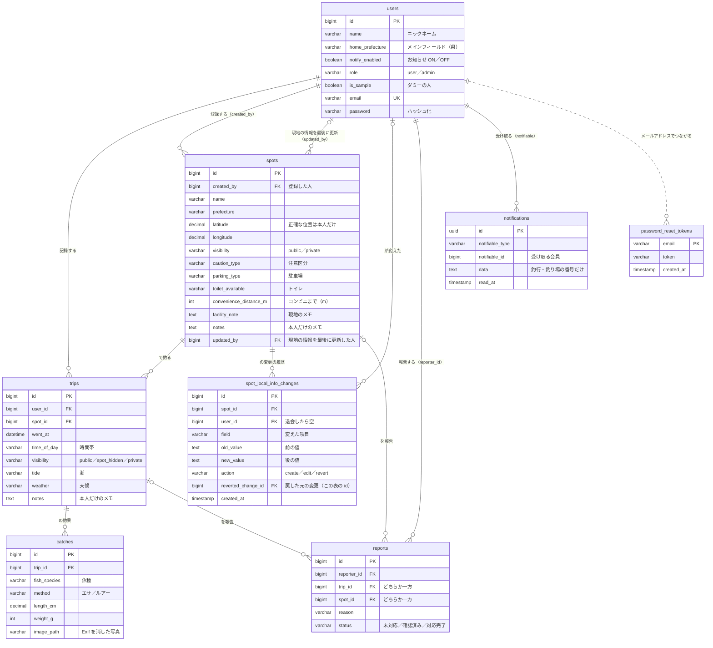

# データベース（ER 図）

## 文書の情報

| 項目 | 内容 |
|---|---|
| 文書名 | FishingLog データベース（ER 図） |
| 版 | 1.0 |
| 作成日 | 2026-10-24（README から移した。図は #200 で Mermaid にしたもの） |
| 最終更新日 | 2026-10-24 |
| 作成者 | kazuyuki-a-dev |

## 改訂履歴

| 版 | 日付 | 変更内容 | Issue |
|---|---|---|---|
| 1.0 | 2026-10-24 | README の「データベース（ER 図）」をこの資料に移した | #221 |

---

アプリで使うテーブルは8つです（users・spots・trips・catches・reports・notifications・password_reset_tokens・spot_local_info_changes）。ほかに、Laravel が最初から作るセッション・キャッシュ・ジョブ用のテーブルがあります。各テーブルの列の説明は、定義書（[`docs/spec.md`](spec.md)）のテーブル一覧とマイグレーション（`database/migrations/`）にあります。

- 図は Mermaid（文字で書く図）で、GitHub がそのまま絵にして表示します。テーブルを足したら、この図も直します（直し忘れは `ErDiagramDocTest` で気づけます）
- 説明に要る列だけを載せています。省いた列：`created_at`・`updated_at`、`spots.parking_note`・`toilet_note`・`notified_at`、`trips.notified_at`、`catches.method_detail`・`notes`、`reports.detail`、`users.email_verified_at`・`remember_token` など
- 線の見方：`||--o{` は「1 対 たくさん」、`|o--o{` は「つながりが空のこともある（退会したら空になる、など）」、点線は外部キーの制約を張っていない（メールアドレスでつながる）つながり
- `notifications.data` には文章を保存せず、釣行・釣り場の番号だけを保存し、表示するたびにその時点の公開範囲をチェックして文章を作ります（あとで非公開に戻しても、釣り場名が残らないように）
- `spot_local_info_changes.reverted_change_id` は、管理者が戻したときの「戻した元の変更」（同じ表の id）です（#200）
- 設計のとき（2026-09-25）に draw.io で描いた初版の図は、Git の履歴（`docs/images/er-diagram.png`、2026-10-23 まで）にあります
